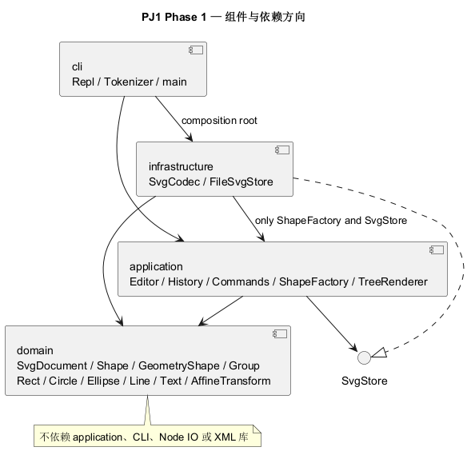

# PJ1 Phase 1 项目文档

本项目依据用户提供的 `phase_cli_1.md` 实现 CLI SVG 编辑器。范围为 rect、circle、ellipse、line、text、g 六种内置图形及要求中的全部命令。实现语言为 TypeScript，采用面向对象建模与 Command 模式。

## 架构方案

### 模块划分及职责

| 目录 | 主要类或文件 | 职责 |
|---|---|---|
| `src/domain/` | Shape、GeometryShape、Rect/Circle/Ellipse/Line/Text、Group、SvgDocument、AffineTransform、Numbers | 封装图形状态、属性验证、几何变换、父子关系、顺序、分组和文档深克隆；不读写文件、不解析命令 |
| `src/application/` | Editor、Command、EditCommand、History、Arguments、CommandRegistry、ShapeFactory、TreeRenderer、SvgStore | 协调会话与命令，管理历史屏障，创建图形，生成结构/属性输出；SvgStore 定义存储端口 |
| `src/application/commands/` | CreateCommand、MoveCommand 等具体命令 | 每个命令验证自己的参数并调用领域行为；front/back 共用参数化的 ZOrderCommand |
| `src/infrastructure/` | SvgCodec、FileSvgStore | XML 编解码、缺失 ID 分配、SVG transform 解析、UTF-8 文件读写及临时文件替换 |
| `src/cli/` | Tokenizer、Repl、main.ts | 双引号与注释分词、逐行交互、错误前缀、提示符；main.ts 是组合入口 |
| `tests/` | 五个 `*.test.ts` 文件、MemoryStore | 领域、命令、文件、CLI 与需求验收；通过内存存储隔离失败场景 |
| `scripts/` | check-architecture.mjs、test.mjs、replay.mjs | 静态架构检查、跨版本测试发现、跨平台案例回放；不包含生产领域逻辑 |
| `examples/`、`doc/`、`.github/workflows/` | 示例、项目文档、CI | 提供可复现的演示与验证材料 |

组件图由 PlantUML 1.2024.8 本地生成，原始文件和矢量文件均提交到仓库。



[PlantUML 源文件](architecture.puml) · [矢量 SVG](architecture.svg)

### 设计模式的选择及落地

| 模式 | 具体实现 | 选择原因 |
|---|---|---|
| **Command（必选）** | [Command](../src/application/Command.ts) 规定执行入口；[EditCommand](../src/application/EditCommand.ts) 提供 execute/undo/redo；具体编辑命令各自独立成类；[History](../src/application/History.ts) 保存命令对象 | 一条编辑命令构成一个历史单元，复杂分组与递归删除也能一次撤销 |
| **Composite** | [Shape](../src/domain/Shape.ts) 为共同抽象，叶子与 [Group](../src/domain/Group.ts) 均实现 move/scale/setAttribute/clone；Group 递归操作子节点 | 命令不判断目标是 rect 还是 g，容器与叶子统一操作，支持任意层级嵌套 |
| **Memento** | EditCommand 私有保存操作前后的 SvgDocument 深克隆；undo/redo 返回新的副本 | 避免浮点逆运算误差，并完整恢复父容器、子树、样式和 z-order |
| **Factory 与依赖反转** | [ShapeFactory](../src/application/ShapeFactory.ts) 创建具体 Shape；Editor 消费 [SvgStore](../src/application/SvgStore.ts)，FileSvgStore 与 MemoryStore 实现端口 | 避免 XML/命令处重复按 tag 分支，也方便替换文件后端与注入 IO 失败 |

所有生产类均一类一文件，文件名与类名相同。几何字段、样式、子节点、会话和历史栈使用 private/protected 字段；attributes() 和 children 返回副本。GeometryShape 封装几何验证及行为，具体图形通过类层次和方法覆盖提供参数约束、显示和克隆，不是公共数据袋。

**仅有两处按命令/图形名字分派，均明确作为后续插件阶段的待重构点：**

1. CommandRegistry 的命令名 → 命令创建器注册表。将来改为可注入的命令注册机制；exit/quit 也在这里分派，REPL 不另设命令分支。
2. ShapeFactory 的类型名 → Shape 构造器注册表。将来改为 ShapeProvider 注册；本阶段仍显式导入六个内置类，不声称已经实现插件零内核改动。

属性白名单判断、分词状态判断属于参数验证，不承担图形类型行为分派；代码中没有 `switch(tag)`。

### 命令执行与状态规则

一次编辑的流程为：分词 → 创建具体 Command → 在当前文档的深克隆上验证/执行 → 成功后替换当前文档、压入命令、清空 redo。如果验证失败或递归编辑中出现数值溢出，副本直接丢弃，当前文档、默认路径及历史保持原样。

init/read/save/canvas 修改尺寸只有成功后才清空历史并设置 IO 屏障。屏障期间 undo 与 redo 均输出 `error: undo not allowed after io command`；下一条成功编辑解除屏障并开始新历史，IO 前的旧编辑不会重新进入历史。canvas 查询及 tree/show/help 不触碰历史。

SVG 自身的画布根节点没有可编辑的图形 ID；内部根容器仅用于统一树操作，不序列化成额外的 `<g>`。普通图形及容器的 ID 大小写敏感、非空且不含空白；导入时也检查画布已有 ID 与图形 ID 的冲突。缺 ID 的图形先扫描全文档的显式 ID，再按标签+序号分配，防止与后面的元素碰撞，成功读入后输出警告。

分组保留所选图形在原文档前序遍历中的顺序，跨父容器时挂到最近公共祖先，并插入其最早被选中分支的位置。group 按命令表要求至少两个成员；空组与单图形容器可通过 create g 和 addto 构建。ungroup 仅允许嵌套普通 g，子节点占据原组的位置；根级 g 必须报错。addto 拒绝自身/祖先循环，并将节点追加到目标末尾。SVG 中后绘制的节点覆盖先绘制节点，因此 front 放在同级末尾，back 放在开头。

普通图形 move 增加位置，line 两个端点同时平移；scale 同乘所有几何位置和尺寸，Group 递归缩放每个子孙一次。缩放不会自动改变 stroke-width 或 font-size，它们不在要求的几何字段内。外部 SVG 的可逆 transform 转为仿射矩阵保存；重新分组、addto、ungroup 用新旧父坐标系之间的矩阵补偿，保留图形的位置。几何字段为局部坐标，move 的增量以目标父容器坐标系解释。

### 依赖方向规则

| 模块 | 允许依赖 | 理由 |
|---|---|---|
| domain | 同层 domain | 保持领域规则独立，不知道 CLI、XML、文件系统或 Node IO |
| application | application、domain | 用例协调领域行为，通过 SvgStore 接口消费存储 |
| infrastructure | infrastructure、domain；application 中仅 SvgStore 与 ShapeFactory；Node IO、两个 XML/transform 库 | 实现存储接口并复用唯一图形工厂，不能反向依赖 Editor/History/CommandRegistry |
| cli | cli、application、infrastructure、domain、Node 终端 API | 作为组合入口注入实现；生产中实际不直接导入 domain |
| tests/scripts | 测试对象或开发工具库 | 属于验证工具，生产 src 不能依赖它们 |

违反规则的依赖应作为待处理项。当前检查未发现违例；工厂的显式类型注册与命令注册仍是上述两个后续重构项。

### 变化点假设

| 可能变化 | 本阶段留下的空间或暂不预留的理由 |
|---|---|
| 新增图形或领域复合图形 | Shape 的多态方法、Group.asGroup 容器能力、ShapeFactory 集中创建；没有实现 box，因为附件明确属于后续阶段 |
| 动态插件及自定义 set 传播 | 可以覆盖 Shape.setAttribute；命令与图形注册表将来开放为注入接口。暂不引入加载器、插件发现或 data-kind 类型还原协议 |
| GUI/Agent 输入通道 | Command/Editor 不依赖 REPL，新的输入适配可以消费相同用例；Tokenizer 只用于 CLI |
| 文件格式或远程存储 | SvgStore 端口隔离 IO；SvgCodec 隔离 XML；本阶段是同步本地文件，无需提前引入网络/异步框架 |
| 大型文档与长历史 | 当前为 O(N) 查找/克隆，K 条历史约需 O(KN) 存储。若测量表明必要，再加入 ID 索引或命令增量 Memento；本次优先完整恢复和简单正确 |
| 更多属性/样式编辑 | 由 Shape/各图形的白名单集中控制。导入额外属性可以保存，但不会自动扩大 CLI 的 set 白名单 |

## 与 AI 协作的过程记录

全部开发发生在 2026-10-14。本节区分用户提出的要求、AI 的实现/自查和工具给出的结果，不虚构人工代码审核或用户逐行修改。

| 阶段与证据 | 讨论、发现或迭代 | 采取的修正及确认方式 |
|---|---|---|
| 需求阅读；用户授权 | 用户提供附件与补充说明，并选择新建 GitHub 私有仓库；AI 提取 TypeScript/OOP、Command、IO 屏障、根级 ungroup 限制、box 阶段边界 | 先建立四层架构与工程骨架，再写领域和命令。用户随后特别提醒不能一次性大提交，后续继续按阶段提交 |
| `56b8cd5` | 工程骨架与初始架构方案 | 首次提交尚无实现；架构文档从这一提交开始持续修订 |
| `cbbfc8a` → `bf82479` | 领域类与 Composite 首轮实现后，严格编译暴露多态 this 与 Group 的类型比较问题；测试暴露静态 Numbers.format 直接传给 map 丢失 this | 用共同 Shape 类型比较，改为闭包调用 Numbers.format；回归测试覆盖 clone 隔离及 transform 重新归属。早期提交的编译失败保留在历史，最终已修正 |
| `bf82479` | group/delete 等树操作若直接改原文档，途中失败可能留下部分修改；undo 后失败命令也不应清空 redo | EditCommand 在独立副本执行；成功才提交文档和历史。加入失败 IO、负尺寸、未知属性、redo 分支测试 |
| `29c530d` | 文件、XML 与 CLI 接入；REPL 初稿把 exit/quit 单独判断，会成为额外分派位置 | exit/quit 改为 ExitCommand 并统一注册。成功回放流程图，生成 8 元素 SVG；临时文件写完后替换目标 |
| `5544fd8` | 自查自动 ID、跨容器顺序、XML 转义和外部 transform；发现初始依赖图没明确说明 SvgCodec 使用 ShapeFactory | 全文预留显式 ID；增加矩阵坐标补偿与 round-trip 测试；将 infrastructure 可依赖的 application 内容明确限定为 SvgStore/ShapeFactory，更新 PlantUML 图 |
| `ec73b6e` | 再对照语法表，group 原实现接受单成员，而表列出 id1、id2… | 将 group 最小成员数改为 2；补全命令参数数量、空 ID、非法数字与失败历史测试 |
| `c1f0fd4` | Windows 最初无法展开测试通配符，曾改为目录发现；CI 又实测 Node 22 将测试目录当作模块，报 MODULE_NOT_FOUND | scripts/test.mjs 显式枚举测试文件并以 argv 传给 Node；不依赖 shell glob 或 Node 目录行为，保留 Node 20/22 支持。CI 取消 fail-fast，四个组合独立验证 |
| 最终文档与验证 | 用户要求的文档与提交不是事后一次生成的代码快照 | 完成本节、自查、功能验收表、实测报告，验证后在最后一次提交处创建并推送附注标签 final |

初始方案的两项实质修订：补充仿射变换值对象以保存外部 SVG 的位置语义；明确 XML 适配器可以使用 application 的 ShapeFactory。四个生产模块和依赖总体方向保持原设计。

## 一致性自查

### 1. 模块划分：实际目录与方案是否一致？

**一致。** 四个生产模块和 commands 子目录均按方案实现；tests/scripts/examples/doc/CI 为辅助目录。新增 AffineTransform、ExitCommand、跨平台测试脚本已经记入上面的修订记录。不存在一个文件塞多个生产类，或把所有几何逻辑放进 CLI 的实现。

### 2. 依赖方向：方案规则是否被违反？

**当前未发现违反。** `npm run check:architecture` 使用 TypeScript AST 检查全部 44 个 src 文件的 import、类名/文件名、顶层自由函数、switch 与按图形 type 比较的分派；同时人工抽样检查运行时职责。抽样结果如下：

| 样本 | 实际依赖/行为 | 判定 |
|---|---|---|
| Rect.ts、GeometryShape.ts | 只导入领域类，私有存储几何字段并验证 | 符合 |
| MoveCommand.ts、ScaleCommand.ts | 查找 Shape 并直接调用 move/scale，不知道具体图形类型 | 符合 Composite |
| Editor.ts | 只消费 SvgStore 接口，无文件系统 import | 符合 |
| SvgCodec.ts | 只使用领域对象、ShapeFactory 与 XML/transform 库 | 符合修订后的规则 |
| FileSvgStore.ts | 实现 SvgStore；文件系统操作集中在这一类 | 符合 |
| Repl.ts、main.ts | REPL 负责输入/输出；入口组装 Editor 与 FileSvgStore | 符合 |
| CommandRegistry.ts、ShapeFactory.ts | 唯一两处命令/图形名字注册分派 | 已标为下一阶段重构点 |

静态检查不能证明任意动态调用都符合设计，因此同时保留源代码抽样和行为测试，没有把工具通过等同于架构必然正确。

## 功能完整性与质量保证手段

### 功能验收对照

| 要求 | 已实现行为与验证依据 |
|---|---|
| init/read/save/canvas | 默认画布、浮点尺寸、读入/默认保存路径、UTF-8、resize、IO 历史屏障；application/svg/requirements 测试 |
| 六种 create 与 in | 每种参数、默认样式省略、可选 fill/stroke、创建时归属；requirements 测试逐类验证；create box/hexagon 报 unknown shape type |
| move/scale/set | 逐类几何属性、line 双端点、text 文本、共同样式、递归容器、严格白名单和正缩放因子；requirements 测试 |
| group/ungroup/addto | 最近公共祖先、原文档顺序、原槽位提升、目标追加、祖先循环/根级限制；domain/application/requirements 测试 |
| delete/front/back | 子树删除、同级前后顺序、精确 XML 撤销恢复；requirements 测试 |
| tree/show/help | 树分支符与内联几何、局部子树、parent 和属性明细、完整命令语法；requirements 测试 |
| undo/redo | 一命令一单元、整组恢复、分支清空、显示透明、IO 禁止直到新编辑；application 测试 |
| 错误原子性 | 文档/redo 不变；即使递归缩放前面的子节点已变化、后面的节点溢出，也不提交；requirements 测试 |
| ID 规则 | 重复/大小写、空白、缺失分配、避开后续显式 ID、警告；svg/requirements 测试 |
| XML 与文件边界 | 实体转义、中文/空文字、额外属性、可逆 transform、写失败临时文件清理、拒绝不支持的结构；svg 测试 |
| 完整典型会话 | examples/session.txt 经实际 CLI 子进程回放；examples/flowchart.txt 检查图形与文字随组移动、undo 后保存；cli 测试 |
| 交互约定 | 实际终端验证 svg>；注释、引号、Windows 路径、单行 error、EOF/exit；cli 测试与终端实测 |

### 可复现的验证

```sh
npm ci
npm run check
npm run test:coverage
npm run demo
npm run demo -- examples/session.txt
```

本地 Windows、Node 20.11.1、TypeScript 5.9.3 验证：**34 项测试通过，0 失败**；44 个生产源文件的架构检查通过。附件 session 回放恰有两条预期错误：非法祖先分组和 save 后 undo；流程图回放没有错误。

严格编译启用了 strict、noUncheckedIndexedAccess、exactOptionalPropertyTypes、noImplicitOverride、noUnusedLocals/Parameters。对撤销和失败场景比较完整序列化 XML，避免只检查一个坐标而漏掉父子关系、顺序或样式。测试包括真实子进程和真实临时文件，不仅测试模拟存储。

另外从远程仓库独立 clone 后执行 npm ci/check，验证锁文件及交付内容可独立安装；npm audit 在官方 registry 的检查结果为 0 vulnerabilities。CI 使用 Ubuntu/Windows × Node 20/22 四组合，实测状态与完整本地输出见 [verification.md](verification.md) 和 [test-report.txt](test-report.txt)。覆盖率可由 test:coverage 复现，但仅作为补充证据，不替代需求语义测试。

### 本阶段边界与限制

外部 SVG 的元素范围同内置六种类型；path/use/defs/tspan 等未支持结构会整体拒绝导入，保留旧文档。非可逆 transform、DOCTYPE、百分比/复杂长度单位也拒绝。画布尺寸可接受 px 后缀，几何字段使用数值 px；支持普通 SVG transform 列表，并以 matrix 序列化。额外样式、font-size、text-anchor 等属性可保存，set 仍严格遵守附件白名单。注释和原始排版不会逐字保留。

没有实现后续阶段的 box 插件。读到 `g data-kind="box"` 时作为普通 g 保存，这是附件规定的未加载插件时的降级路径；因此不冒充已注册复合图形，也不会触发后续插件专用的 cannot ungroup composite shape 错误。

### Git 提交与最终标签核验

远程仓库：[loading-9/pj1-svg-editor](https://github.com/loading-9/pj1-svg-editor)（私有）。使用真实的逐步提交，未重写早期失败或把最后代码拆成虚构历史。最终版本以附注标签 `final` 指向最后一次提交，并推送 main 和 final。

```sh
git log --oneline --reverse
git show --no-patch final
git rev-parse HEAD 'final^{commit}'
git ls-remote origin refs/heads/main refs/tags/final 'refs/tags/final^{}'
```

附件没有提供具体提交截止时间；标签的实际创建时间保存在附注标签中，可由 git show 核验。因为仓库按用户要求设为私有，提交给课程时需保证评阅者具有仓库读取权限。
