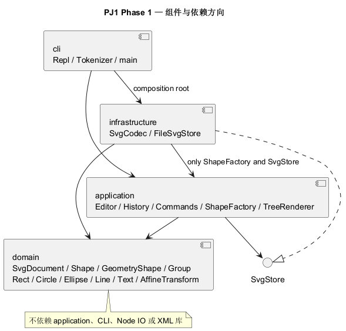
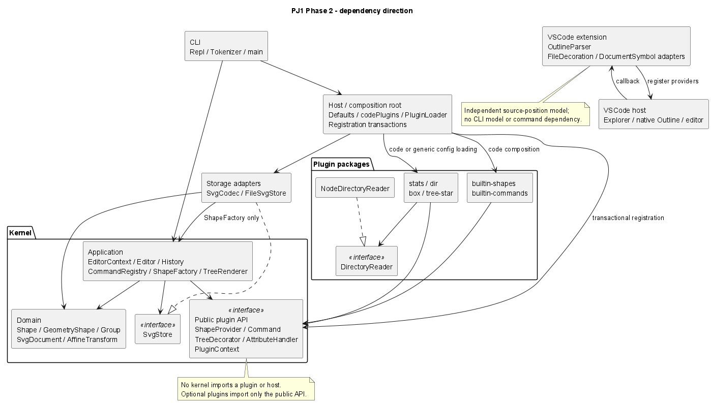

# PJ1 Phase 2：插件实践与插件式重构

TypeScript 面向对象实现的 SVG 编辑器。Phase 2 保留 Phase 1 行为，将图形、命令、树标签和属性语义开放为插件，并提供独立的 VSCode 文件标记与原生大纲扩展。

CLI 自动化验证和 VSCode 实机验证已完成。[截图与操作结果](screenshots/README.md)

## 运行与装配

需要 Node.js 20+ 和 npm。在仓库根目录运行：

```sh
npm ci
npm run build
# Phase 1 缺省能力，不加载本阶段可选插件
node dist/src/cli/main.js
# A：代码装配
node dist/src/cli/main.js --code
# B：配置装配
node dist/src/cli/main.js --config plugins.config.json
```

无参数入口提供六种图形和原有命令；可选插件未加载时 stats/dir 是未知命令，box 是未知类型，tree 不附标签，set 使用 Phase 1 白名单。配置中的所有可选项可单独 enabled:false；内置能力仍由 Defaults 通过同一加载事务装配。

### 代码装配 A

[src/host/codePlugins.ts](../src/host/codePlugins.ts) 导入插件默认实例及清单，决定集合和顺序；main 依次调用 PluginLoader.activate。当前顺序 stats → dir → box → tree-star，options 均缺省。新增插件只改这一顶层文件，接口和加载器不改。

### 配置装配 B

根目录 [plugins.config.json](../plugins.config.json) 使用以下结构：

```json
{
  "plugins": [
    { "module": "./plugins/stats" },
    { "module": "./plugins/dir" },
    { "module": "./plugins/box" },
    { "module": "./plugins/tree-star" },
    { "module": "uninstalled-example", "enabled": false }
  ]
}
```

相对 module 以配置文件目录为基准；包名遵循 Node 的模块解析规则。数组顺序即加载顺序；false 项不解析、不求值。options 作为第二个参数原样传入 activate，例如 box 可使用 `"options": {"fill":"orange"}`。两个入口都使用同一 PluginLoader.activate、Registration 和扩展对象，不存在只对配置有效的另一套实现。

每个插件目录有 package.json，main 指向构建产物，contributes 使用 shapes/commands/decorators/attributes 四个名称集合。缺省类别为空，名称在同类别中全局唯一。项目内的插件默认导出实现 Plugin 的类实例，activate 同步返回 void；类、参数、上下文均有 TypeScript 类型检查。内置实现也经相同注册路径加载。

[src/host/PluginLoader.ts](../src/host/PluginLoader.ts) 只处理模块解析、通用清单与事务，不导入具体可选插件；源码中的具体导入在装配文件。当前支持 Node 可以 require 的 CommonJS 入口；TS 源码先编译为对应 JS。

## 架构方案与重构对比

### Phase 1



[PlantUML 源](architecture.puml)。原来的 CommandRegistry 硬编码内置命令构造器，ShapeFactory 硬编码六种类型，TreeRenderer 直接输出标题，set 直接调用图形属性白名单。新增名字或树标签需要修改既有实现。Phase 1 历史文档可在 [final 的 doc/README.md](https://github.com/loading-9/pj1-svg-editor/blob/final/doc/README.md) 查看。

### Phase 2



[PlantUML 源](phase2-architecture.puml) · [矢量图](phase2-architecture.svg)。内核依赖抽象，具体实现由外侧宿主装入。public API 与外部模块之间的箭头表示导入依赖；宿主对插件的加载不构成内核反向依赖。

| 模块 | 职责与允许依赖 |
|---|---|
| src/domain | Shape、GeometryShape、Group、SvgDocument、仿射变换和值验证；只依赖同层。Group 是公开 Composite 容器基础，普通 g 由内置提供器注册 |
| src/application | Command/EditorContext、编辑事务与历史、四个扩展点、注册表查询、树渲染；只依赖 application/domain，不知道插件包名、宿主、XML 或 Node IO |
| src/api.ts | 插件公共入口，导出领域抽象、扩展契约及稳定的命令支持类型；插件不导入 src 内部路径 |
| src/infrastructure | SvgCodec、FileSvgStore；通过注入 ShapeFactory 读回已注册类型，实现 SvgStore；允许依赖领域与相应应用端口，不装配插件 |
| src/host | Defaults、codePlugins、PluginLoader、Registration；负责模块加载、清单校验、临时注册与装配；依赖内核、存储适配器及具体插件，内核不依赖它 |
| src/cli | Tokenizer、Repl、main；输入输出和最外层入口，不放图形或插件行为分支 |
| plugins/builtin-shapes | 六个 ShapeProvider 与既有叶子图形实现；通过公共 API 创建公开领域对象 |
| plugins/builtin-commands | 原有命令及其装配插件；使用 EditorContext/PluginContext 端口，不直接创建注册表或渲染器 |
| plugins/stats、dir、box、tree-star | 相互独立的可选包，只依赖公共 API 与本包代码；dir 的 Node 文件系统适配器封装于本包 |
| vscode-extension | 独立的 XML 位置树与两个 VSCode 适配器，不依赖 CLI 的模型或宿主 |
| tests、scripts、doc、docs/metrics | 独立插件/集成测试、可复现验证、历史指标和文档，不参与生产调用 |

原有叶子与命令采用移动后注册，保持算法、语法和输出；不重写为公共数据袋。每个生产类独立成文件，状态字段封装。脚本可使用自由函数，但领域逻辑与插件行为使用类。

### 扩展点清单

以下路径中的方法就是内核侧实际调用位置；ExtensionPoint 接口不包含任何插件名字。

| 接口、职责 | 内核调用位置 | 已有实现 | 禁用可选扩展时 | 违反契约的处理 |
|---|---|---|---|---|
| [ShapeProvider](../src/application/ShapeProvider.ts)：创建与读回图形，提供类型名及 help 语法 | ShapeFactory.create/read；SvgCodec.decode 在读完子树后 validate | BuiltinShapeProvider（六种）；BoxProvider | 内置六种仍可用；box create 报 unknown shape type，带 data-kind 的 g 按普通组读回 | 注册方法/priority/syntax 不合法拒绝激活；返回 ID 错误报 shape provider returned wrong id；同优先级多个 reader 命中报 ambiguous shape readers；图形校验失败整条命令/读入回滚 |
| [Command](../src/application/Command.ts) + CommandProvider：命令对象、名称、参数与语法 | CommandRegistry.run → provider.create → Command.run；命令通过 EditorContext 操作 | BuiltinCommands 中原命令；StatsCommand；DirCommand | stats/dir 从 help 消失，执行报 unknown command | 注册缺 create/syntax 拒绝激活；参数由命令 Arguments 校验；运行异常统一 error: 单行显示；编辑通过 EditCommand 获得回滚 |
| [TreeDecorator](../src/application/TreeDecorator.ts)：每行行尾标签 | TreeRenderer.tree/children → suffix → decorate（根行 shape 为 undefined） | BoxTypeLabel、ModifiedStar | 无标签，Phase 1 tree 逐字节不变 | 缺 decorate 拒绝激活；抛错、多行或非字符串返回、修改视图均使本次显示报错，编辑器文档不变 |
| [AttributeHandler](../src/application/AttributeHandler.ts)：属性领域语义 | SetCommand.apply → PluginContext.setAttribute → Extensions.set | BoxAttributes 的 fill/label | 按 Phase 1 目标图形白名单处理；未知 label 报 unknown attribute | handles 必须纯；多命中拒绝；apply 失败不回退默认处理。工作副本丢弃，当前文档及 undo/redo 保持不变 |

[PluginContext](../src/application/Plugin.ts) 提供注册和公开服务。Command 参数类型是 EditorContext，内置显示命令通过 renderTree/showShape 服务调用渲染，避免依赖实现类。属性处理也通过上下文服务接入。ctx 在激活结束后关闭注册；保留引用不能迟到注册。

### 模式及设计决策

| 模式/原则 | 落地 |
|---|---|
| Command + Memento | 原有具体命令仍独立成类；EditCommand 在文档副本执行，History 一条命令对应一单元，保留 Phase 1 IO 屏障 |
| Composite | Group 与叶子共用 Shape 行为；Box 是有不变量的 Group 子类，移动、缩放、删除和嵌套沿用通用树操作 |
| Factory / Strategy | ShapeFactory 选择已注册 ShapeProvider；Extensions 选择属性策略；不枚举具体图形类 |
| Adapter | NodeDirectoryReader 将 Node Dirent/process 接口转换为 DirectoryReader；VSCode 的 Symbol 适配器将 XML 位置树转换为 DocumentSymbol |
| 标签组合与 Decorator | 结构树用有序 TreeDecorator 链组合标签。它实现附加展示行为，但不是包装相同 Component 接口的经典 GoF Decorator；两者差异如实区分 |
| OCP / 依赖反转 | 插件依赖内核契约，宿主依赖具体插件，内核不导入插件。新增 box、标签的接入提交不改内核/渲染器；A/B 提交差异有可运行证据 |

## 命令、属性与图形行为

### stats

按画布子节点顺序深度优先遍历，首次出现的叶子类型决定输出顺序。普通 g/box 计入 containers，SVG 根不计；box 内部 rect/text 仍计入叶子与 total。空文档输出 `(total 0, containers 0)`；它是显示命令，不触碰历史。

### dir 与目录适配器

[DirectoryReader](../plugins/dir/DirectoryReader.ts) 是命令所需 Target；[NodeDirectoryReader](../plugins/dir/NodeDirectoryReader.ts) 是 Adapter；Node 的 readdirSync/Dirent/process.cwd 是 Adaptee；DirCommand 是 Client。命令可注入测试替身，默认插件使用真实适配器；两种装配共用同一 DirPlugin/DirCommand/DirectoryReader。

只列进程 cwd 的直接子项，包含隐藏项，不递归、不跟随符号链接；read/save 不改变 cwd。目录先于文件，各组按 Unicode UTF-16 码元的大小比较升序排序，避免 locale 差异。特殊项排在文件后，符号链接显示 `[LINK]  name`，其他特殊项显示 `[OTHER]  name`；不遍历其目标。空目录显示 `(empty directory)`；失败报 `error: cannot read directory: <path>`，REPL 继续。未 init/read 也能用，成功失败均不改变文档、保存基线、cwd 与 undo/redo。

### box 与属性处理

BoxProvider 创建 `<id>-rect`/`<id>-label`，默认蓝色、标题位置 x+20/y+35；可通过 in、addto、group、move/scale 等通用命令组合。set box fill 传播到 frame；label 修改 title；普通矩形没有 label 属性。必要部件不能被 delete/addto/group/front/back 拆离；整体 box 可以删除或被其他容器收编。ungroup 总是拒绝复合图形。

`data-kind=box` 随普通 SVG g 保存；装插件时严格验证结构，未装时降级为普通 g。派生 ID 冲突和重复 ID 都整条失败。Box 本身及子节点通过深克隆参加 undo/redo。

### 设计记录 ADR

1. [属性命中、冲突规则与事务边界](adr/001-attribute-transactions.md)
2. [box 结构、读回、降级与部件保护](adr/002-box-round-trip.md)
3. [dirty 内容比较、祖先传播、标签顺序](adr/003-dirty-labels.md)
4. [统一加载、清单校验与激活失败隔离](adr/004-loader-transactions.md)

## VSCode 扩展实践

源码、启动/安装步骤、示例、模式分析与复用评估见 [vscode-extension/README.md](../vscode-extension/README.md)。根目录运行 `npm run build:extension` 后，在 VSCode 选择 **SVG Mark and Outline** 调试配置并按 F5。

VSCode 管理原生 Explorer/Outline、文档变更调度、源码定位与 Disposable 生命周期；扩展注册文件装饰和文档符号提供器，由宿主回调。标记只读 URI/fs.stat，不修改名称和内容；符号树包含根、分组与叶子，节点带 UTF-16 源码范围，无 ID 时只显示标签名。不完整 XML 返回空列表，后续合法输入可以恢复。

文件装饰在效果上类似 Decorator，但没有包装同接口 Component；DocumentSymbolProvider 明确把解析结果适配为 VSCode 类型。Phase 1 SvgCodec 会补 ID、限制元素并丢失源码偏移，不能直接用于编辑过程的大纲，因此复用 Composite 遍历思路，另建位置树。扩展与 CLI 源码没有耦合。

实机验证覆盖原生大纲对照、文件标记、源码定位、编辑更新和错误恢复。[截图与操作结果](screenshots/README.md)

## AI 协作中的检查与修正

开发过程保留普通 commit，不用一个大提交伪造阶段。

| 检查或问题 | 修正及验证 |
|---|---|
| Phase 1 构造器默认创建具体内置实现，会使“只换注册表”仍保留反向依赖 | 先搬移叶子与命令，默认装配移到 Defaults；原断言保留，仅替换测试装配。独立编译 final，比对同一基础会话和 help，stdout 逐字节相同 |
| 属性处理器只传 id 不足以表达工作副本和多个部件修改 | 采用公开 Shape/工作文档上下文；多命中拒绝，失败丢弃副本；用先改两个节点再抛错、redo 分支测试确认 |
| 清单只在注册前检查无法发现漏注册、额外注册与部分失败 | 统一暂存→激活→关闭→集合核对→发布；四类加载失败、重复及部分注册回滚都有测试；内部依赖缺失不误报顶层 not found |
| 首版插件支持类仍引用 Editor、ShapeFactory、TreeRenderer 的实现类型 | 检查依赖后改用 EditorContext 及 PluginContext 的创建/属性/显示服务；只有宿主组合实现，插件只依赖公共 API |
| box 的创建 ID 检查若只看容器会漏掉派生部件 | add 检查整棵新增子树；Box 校验必要部件，remove 保护结构；重复/缺失/错误类型及失败读入保留旧文档测试通过 |
| dirty 若只记录发生过编辑就无法识别 undo 回保存点 | 改为保存快照内容比较，在标签实例封装缓存；独立状态机和真实 Editor 的保存/撤销测试覆盖 |
| 树标签测试的注册替身最初返回了对象，违反 void 类型契约 | 严格编译发现，单独后续提交修正替身；没有重写前一提交。最终全部检查通过 |
| 扩展打包初稿依赖当前工作目录，从其他目录调用失败 | 改为相对脚本 URL 定位项目根；独立构建输出仅保留外部 vscode API，由宿主提供 |
| Outline 跳转可能重开 SVG 图片预览 | 用示例工作区设置关联文本编辑器，重新验证 rect#start 跳到第 3 行第 6 列 |

## 一致性与质量保证

实际目录与上述方案一致。83 个生产 TypeScript 文件通过架构检查：类名与文件名、公共 API 边界、内核独立性、VSCode 隔离；结合源码检查确认插件不直接导入宿主或内部目录。注册表不枚举可选插件名，加载器无具体插件映射。

```sh
npm run check
npm run build:extension
npm run verify:compatibility
npm run verify:git
```

当前 63 项测试通过，0 失败：

- 原 Phase 1 的 36 项领域、命令、CLI、SVG 和文件测试继续执行。
- 各可选插件独立测试使用公开上下文或端口替身；box 的独立测试不导入其他插件。
- dir 覆盖混合项、隐藏项、空目录、稳定排序、失败和真实临时文件系统，以及无文档/历史不变。
- 加载器覆盖指定四条错误、重复、回滚、继续加载、配置路径、包名、options、disabled、非法配置、异步拒绝与不合法接口。
- 属性处理覆盖默认白名单、多命中、双部件单单元撤销/重做、部分失败与无副作用判断；标签覆盖 dirty 状态机及组合。
- VSCode 提供器自动化覆盖嵌套/无 ID/源码位置/更新/不完整 XML/恢复/装饰筛选/注册释放。实机证据另见截图记录。

[compatibility.json](transcript/compatibility.json) 记录 final 基线独立编译以及三份双装配会话的逐字节结果。命令输入为纯命令/注释，不含提示符或输出；同名 code/config.out.txt 为输出。基础输入引用的 SVG 是 [examples/other.svg](../examples/other.svg)。dir 会话在固定临时目录运行，所有日志存到目录外，不由日志改变目录列表。

[Git 差异证据](verification/git-boundaries.json) 由脚本验证：先确认保护路径实际存在，再检查接入提交的内核、加载器和既有插件差异为空。它检查具体历史提交，不以当前目录的空 diff 冒充插件接入证据。

远程既有 CI 在代码/测试版本 `0fb3832` 的 Ubuntu/Windows × Node 20/22 四组合均成功，[运行记录](https://github.com/loading-9/pj1-svg-editor/actions/runs/43701276644) 与 [校验结果](verification/ci.json) 可复核。该工作流执行 npm ci/check；其他独立性、打包、双装配与 Git 边界验证由本地报告分别记录，不混称为 CI 检查项。当前推送认证未授予 workflow scope，因而保留原有工作流，未要求额外权限。

### 指标与可复现材料

[docs/metrics](../docs/metrics/README.md) 提供当前代码与 final 的文件清单、职责、物理行数和聚合圈复杂度；[首次框架指标](../docs/metrics/framework/README.md) 保留首轮产出。脚本从 Git 对象生成，CLI 按内核/装配处/插件拆分，VSCode 单列，不计依赖、构建产物、测试和脚本。对最终 p2 可再运行：

```sh
node scripts/metrics.mjs --to p2 --label p2
```

指标对应 `p2` 的生产 TypeScript 文件。

### Git 与交付状态

仓库：[loading-9/pj1-svg-editor](https://github.com/loading-9/pj1-svg-editor)，保持公开。沿用 Phase 1 全部历史，不 squash、不改旧标签。

| 提交 | 过程节点与证据 |
|---|---|
| f590325 | Phase 2 方案和分步验证规划 |
| 3196d48 | VSCode 扩展源码、示例、独立构建及提供器测试 |
| 8f52331 | 四个扩展点、通用加载事务、内置插件化、第一份指标及 final 基线对照 |
| 61f5d47 | stats/dir 插件、目录端口与 Node 适配器、独立及真实 IO 测试 |
| 2a02cc0 | box 代码装配 A：只新增 box 包、测试，改一个 codePlugins 顶层文件 |
| 3a22dba | box 配置装配 B：仅修改 plugins.config.json，既有运行源码不变 |
| 2fc0d9f → 808ffc4 | modified-star 与 box 标签共存；后续修正测试替身类型 |
| 0c4f272 | 收紧公共依赖、运行契约防护、完整双装配验证与 Git 差异证据 |

```sh
git show --no-patch final
git show --no-patch final-initial
git diff --name-status 2a02cc0^ 2a02cc0
git diff --name-status 3a22dba^ 3a22dba
node scripts/verify-git-boundaries.mjs
```

旧标签对象：final 为 a00e3f227274f3f792efee91c8c46d35f2b4cff3；final-initial 为 0d1371d9c5dc9e432334cb7f905e202e117865d6。最终提交使用本地 `p2` 标签，远程发布暂缓。

### 变化点与限制

未来新图形、命令、标签和属性语义由插件扩展；按配置接入无需改运行源码。大文档可按测量结果优化全量克隆/指纹；当前优先回滚正确性。模块加载同步，插件为受信同进程代码，不承诺隔离其外部 IO。SVG 文件范围继续沿用 Phase 1，未支持元素不静默丢失。尚未实现选做 diamond/arrow，未列入交付功能。
